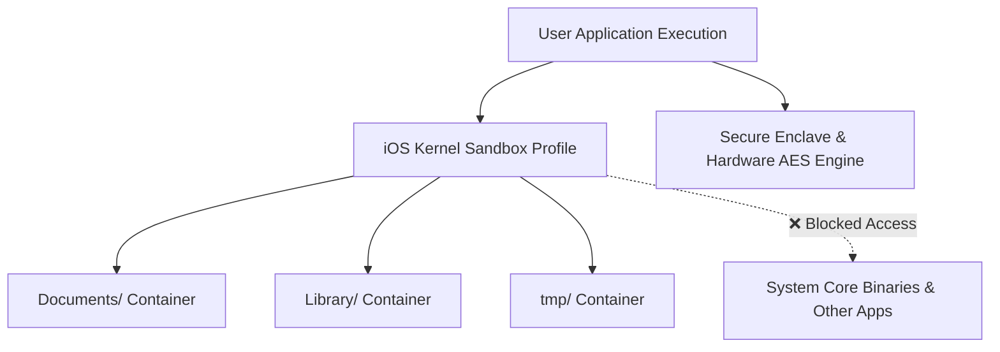

# 01. Case Study: Mobile OS (Android and iOS)

> **Syllabus Units:** Block 3 Unit 3 / Block 4 Units 3 & 4 | **Rank:** #1 | **Frequency Score:** 11.8 | **Offered Marks:** 215 | **Papers Present:** 9/9 | **Importance:** Very High  
> **Coverage:** 17 canonical questions across all 9 TEE papers (Dec 2021 – Dec 2025), ranked by historical repetition and examiner emphasis.

---

## ❓ Question Bank & Canonical Answers

### Q001: Detail the directory architecture of an iOS Application Sandbox container and the role of the iCloud Container. :id=q001

🔴 **Very High Priority** • **3 (30 marks)** • *Theory / Short Answer*

**💡 Key Answer Points:**
To prevent system-wide compromise, iOS confines each app to an isolated container. The standard directories are:

| Directory Name | Access Permission | Backup Behavior | Primary Purpose & Usage |
| :--- | :---: | :---: | :--- |
| `<Application_Home>/AppName.app` | **Read-Only** | Not Backed Up | The compiled application bundle containing binary executable code and packaged static assets. |
| `Documents/` | **Read/Write** | **Backed Up** (iTunes/iCloud) | User-created documents and content that cannot be recreated (e.g., text drafts, user photos, database saves). |
| `Library/` | **Read/Write** | Partially Backed Up | Top-level directory for non-user files. Subdivided into `Library/Preferences` (backed up) and `Library/Caches` (not backed up). |
| `tmp/` | **Read/Write** | Not Backed Up | Temporary scratch files that do not need to persist across app launches; OS may purge these when free disk space is low. |

- **iCloud Container:** A cloud-synchronized directory managed by the OS ubiquity service. Changes made to files in this container are automatically synchronized via Apple servers across all devices registered to the same Apple ID, providing seamless state restoration.

**📝 Example PQP Question (Dec 2021 Q1(c)):**

List and explain various commonly used directories in iOS. Also mention the purpose of iCloud container of iOS along with its contents. *(10 marks)*

> **🗓️ Asked In Papers:** [Dec 2021 Q4(a)](/bca_new/mcs203/pqp/MCS-203_Dec_2021.pdf ':ignore'), [June 2023 Q5(a)](/bca_new/mcs203/pqp/MCS-203_June_2023.pdf ':ignore'), [Dec 2024 Q5(d)](/bca_new/mcs203/pqp/MCS-203_Dec_2024.pdf ':ignore')

---

---

### Q002: Draw and explain the four-layer architectural stack of Apple's iOS SDK. :id=q002

🔴 **Very High Priority** • **3 (30 marks)** • *Theory / Diagram & Architecture*

**💡 Key Answer Points:**
Apple's iOS is structured into four distinct vertical layers, where upper layers provide high-level abstractions and lower layers interface directly with hardware.

```
+-----------------------------------------------------------------+
|                       COCOA TOUCH LAYER                         |
|   UIKit | SwiftUI | MapKit | EventKit | Push Notifications       |
+-----------------------------------------------------------------+
|                          MEDIA LAYER                            |
|   Core Animation | AVFoundation | Metal | Core Graphics | Audio |
+-----------------------------------------------------------------+
|                      CORE SERVICES LAYER                        |
|   Core Data | Core Foundation | CloudKit | SQLite | Networking  |
+-----------------------------------------------------------------+
|                         CORE OS LAYER                           |
|   Darwin Kernel (XNU: Mach + BSD) | Hardware Drivers            |
|   Secure Enclave Driver | Memory Allocation | Sockets | POSIX   |
+-----------------------------------------------------------------+
```

1. **Cocoa Touch Layer:** The topmost user-facing layer managing touch events, windowing, and visual controls. Built on **UIKit** and **SwiftUI**, it handles touch dispatch, gestures, alerts, and navigation controllers.
2. **Media Layer:** Provides specialized frameworks for 2D/3D graphics, audio processing, and video playback. Features **Metal** (ultra-low-overhead GPU programming), **Core Animation**, and **AVFoundation**.
3. **Core Services Layer:** Supplies fundamental system services below the UI. Includes **Core Data** (object graph persistence), **Core Foundation** (C-based data management), network sockets, and GPS Location services.
4. **Core OS Layer:** The lowest substrate resting on hardware. Built on **Darwin** (the XNU hybrid kernel combining Mach microkernel message passing with FreeBSD POSIX semantics). Coordinates virtual memory paging, file systems, low-level socket APIs, and communication with the Secure Enclave processor.

**📝 Example PQP Question (Dec 2025 Q4(b)):**

Give the complete layered architecture of iOS. Briefly explain about each layer and their significances. *(10 marks)*

> **🗓️ Asked In Papers:** [June 2024 Q1(c)](/bca_new/mcs203/pqp/MCS-203_June_2024.pdf ':ignore'), [June 2025 Q1(d)](/bca_new/mcs203/pqp/MCS-203_June_2025.pdf ':ignore'), [Dec 2025 Q4(b)](/bca_new/mcs203/pqp/MCS-203_Dec_2025.pdf ':ignore')

---

---

### Q003: Draw and explain the layered architectural stack of the Android Operating System. :id=q003

🔴 **Very High Priority** • **2 (20 marks)** • *Theory / Diagram & Architecture*

**💡 Key Answer Points:**
Android is structured as a layered software stack built on top of an open-source Linux kernel.

```
+-----------------------------------------------------------------+
|                   APPLICATIONS (USER SPACE)                     |
|           Home, Phone, Contacts, Browser, Third-Party Apps       |
+-----------------------------------------------------------------+
|                     APPLICATION FRAMEWORK                       |
|   Activity Manager | Window Manager | Content Providers | Views  |
|   Resource Manager | Notification Manager | Package Manager     |
+-----------------------------------------------------------------+
|       ANDROID RUNTIME (ART)       |      LIBRARIES (C/C++)      |
|   Core Java Libraries             |   WebKit, OpenGL ES, SQLite |
|   Ahead-of-Time (AOT) Compiler    |   Media Framework, FreeType |
|   Garbage Collection, Dalvik Byte |   SSL/Crypto, Surface Mgr   |
+-----------------------------------------------------------------+
|                 HARDWARE ABSTRACTION LAYER (HAL)                |
|       Camera, Audio, Bluetooth, Sensors, RIL, Wi-Fi HAL         |
+-----------------------------------------------------------------+
|                          LINUX KERNEL                           |
|   Process Scheduler | Memory Manager | IPC (Binder) Driver      |
|   Power Management  | Display Driver | USB/Camera Drivers       |
+-----------------------------------------------------------------+
```

1. **Linux Kernel Layer:** Foundational layer providing CPU scheduling, virtual memory management, low-level security, network stack, and device drivers.
2. **Hardware Abstraction Layer (HAL):** Standard interface exposing device hardware capabilities to high-level Java APIs through device-specific library modules.
3. **Android Runtime (ART) & Native Libraries:**
   - **ART:** Replaced the legacy Dalvik VM; utilizes Ahead-Of-Time (AOT) and Just-In-Time (JIT) compilation to run DEX (Dalvik Executable) bytecode with low memory overhead.
   - **C/C++ Libraries:** Pre-compiled system libraries such as SQLite (database), WebKit (browser rendering), OpenGL ES (3D graphics), and Surface Manager.
4. **Application Framework Layer:** Java classes used directly by developers (e.g., Activity Manager for lifecycle, Content Providers for data sharing, Notification Manager for alerts).
5. **Applications Layer:** Native system applications (Phone, Messages) and third-party applications installed by the user.

**📝 Example PQP Question (Dec 2024 Q2(c)):**

Discuss the layered architecture of Android OS, with the help of a diagram. *(10 marks)*

> **🗓️ Asked In Papers:** [Dec 2022 Q1(d)](/bca_new/mcs203/pqp/MCS-203_Dec_2022.pdf ':ignore'), [Dec 2024 Q2(c)](/bca_new/mcs203/pqp/MCS-203_Dec_2024.pdf ':ignore')

---

---

### Q004: Explain memory management in Android and the role of the Low Memory Killer (LMK). :id=q004

🔴 **Very High Priority** • **2 (20 marks)** • *Theory / Long Answer*

**💡 Key Answer Points:**
- **No Swap Space Policy:** Android does not support disk swapping to protect flash storage from write degradation and prevent performance lag.
- **Shared Memory Management:** Uses the Linux virtual memory manager with **ashmem** (Android Shared Memory) to allow processes to share memory buffers safely.
- **The Low Memory Killer (LMK):**
  - The LMK is a kernel-level driver that monitors free physical memory against multiple watermarks.
  - When available RAM drops below a predefined threshold, LMK scans processes and terminates the lowest-priority process using its assigned `oom_adj` (Out-Of-Memory Adjudication) score.
  - Empty processes and cached background tasks are killed first; active foreground apps and running services are protected.

```
Low Memory Reclaim Order:
[Empty Cached Apps] -> [Background Apps] -> [Service Processes] -> [Visible Apps] -> [Foreground App (Protected)]
```

**📝 Example PQP Question (Dec 2023 Q4(b)):**

Explain the memory management in Android Operating System. *(10 marks)*

> **🗓️ Asked In Papers:** [June 2023 Q5(d)](/bca_new/mcs203/pqp/MCS-203_June_2023.pdf ':ignore'), [Dec 2023 Q4(b)](/bca_new/mcs203/pqp/MCS-203_Dec_2023.pdf ':ignore')

---

---

### Q005: Provide a comprehensive comparison between Symbian OS and Android OS. :id=q005

🔴 **Very High Priority** • **2 (10 marks)** • *Theory / Comparison Table*

**💡 Key Answer Points:**

| Evaluation Metric | Symbian OS | Android OS |
| :--- | :--- | :--- |
| **Kernel Type** | **Microkernel** (EKA1 / EKA2) prioritizing real-time responsiveness and small footprint. | Modified **Monolithic Linux Kernel** (v4.x/5.x) providing standard driver abstractions. |
| **User Interface** | Fixed, keypad-oriented UI (Series 60 / UIQ) designed for non-touch screens. | Dynamic, rich capacitive multi-touch interface with hardware-accelerated fluid animations. |
| **Programming Language** | Complex native Symbian C++ requiring custom cleanup stacks (`CleanupStack::PushL()`). | Java / Kotlin targeting the Android API framework, with native C/C++ via NDK. |
| **Runtime Engine** | Direct native ARM machine code execution. | Virtual Machine execution: Dalvik VM / Android Runtime (ART) running DEX bytecode. |
| **Application Ecosystem** | Fragmented SIS package installers with cumbersome certificate signing. | Unified **Google Play Store** distribution using APK and Android App Bundles (AAB). |
| **Licensing** | Closed proprietary ownership (Nokia / Symbian Ltd.); failed open-source transition. | **Open Source** (Apache 2.0 for user-space, GPL v2 for Linux kernel). |
| **Security Architecture** | Capability-based security model checked via developer signing certificates. | Multi-tier security: Linux UID isolation, Android Sandbox, runtime permissions, and SELinux. |

**📝 Example PQP Question (Dec 2021 Q5(c)):**

Write short notes on: Comparative chart of Symbian, Android with respect to the features : OS family, user interface, app stores, licence policy, security, voice assistant and power management. *(5 marks)*

> **🗓️ Asked In Papers:** [Dec 2021 Q5(c)](/bca_new/mcs203/pqp/MCS-203_Dec_2021.pdf ':ignore'), [Dec 2025 Q5(c)](/bca_new/mcs203/pqp/MCS-203_Dec_2025.pdf ':ignore')

---

---

### Q006: Explain the file management system and security model in iOS. :id=q006

🔴 **Very High Priority** • **1 (10 marks)** • *Theory / Long Answer*

**💡 Key Answer Points:**
- **Application Sandbox Boundary:** Each iOS app is strictly isolated inside its own private directory container at runtime. Apps cannot traverse outside their container directory or read/write other applications' data.
- **Kernel-Level Enforcement:** Sandboxing is enforced directly by the Darwin / XNU hybrid kernel through sandboxing profiles compiled into the system.
- **Data Protection & Encryption:** Hardware-backed cryptographic protection using the AES-256 crypto engine and Apple's **Secure Enclave**. Files are assigned protection classes (e.g., Complete Protection, Protected Unless Open).
- **Keychain Services:** Secure, encrypted SQLite database managed by the OS to store passwords, cryptographic keys, and sensitive tokens outside user files.



**📝 Example PQP Question (June 2022 Q1(c)):**

Explain the file management system in iOS and also briefly mention the security aspects of file system. *(10 marks)*

> **🗓️ Asked In Papers:** [June 2022 Q4(a)](/bca_new/mcs203/pqp/MCS-203_June_2022.pdf ':ignore')

---

---

### Q007: Explain the Android Process Lifecycle and its five priority states. :id=q007

🔴 **Very High Priority** • **1 (10 marks)** • *Theory / Lifecycle Hierarchy*

**💡 Key Answer Points:**
The Android OS manages app processes based on an explicit 5-level priority hierarchy:

```
HIGHEST PRIORITY (Killed Last)
  ▲   1. Foreground Process   (User actively interacting with on-screen Activity)
  │   2. Visible Process      (Visible but non-interactive, e.g. behind a dialog)
  │   3. Service Process      (Background worker without UI, e.g. music playback)
  │   4. Background Process   (Minimized app in back stack; Activity stopped)
  │   5. Empty Process        (Contains no active components; held as memory cache)
LOWEST PRIORITY (Killed First)
```

1. **Foreground Process:** An app currently executing code the user is interacting with (e.g., top-level Activity resumed, active Broadcast Receiver).
2. **Visible Process:** Has no foreground components but directly impacts what the user sees (e.g., an Activity paused by a permissions dialog or an active Live Wallpaper).
3. **Service Process:** Running an ongoing background task started via `startService()` that has no visible UI (e.g., background music streaming or file downloading).
4. **Background Process:** Holds Activities that are completely obscured from view (`onStop()` called). Preserved in an LRU (Least Recently Used) list.
5. **Empty Process:** Holds zero active application components; maintained purely as a cached process to accelerate subsequent app restart times.

**📝 Example PQP Question (June 2025 Q3(a)):**

Discuss the following processes in Android mobile operating system :

(i) Foreground process
(ii) Visible process
(iii) Service process
(iv) Background process
(v) Empty process *(10 marks)*

> **🗓️ Asked In Papers:** [June 2025 Q3(a)](/bca_new/mcs203/pqp/MCS-203_June_2025.pdf ':ignore')

---

---

### Q008: Explain the primary design issues and hardware constraints of Mobile Operating Systems. :id=q008

🟠 **High Priority** • **3 (30 marks)** • *Theory / Long Answer*

**💡 Key Answer Points:**
Mobile OS design differs fundamentally from desktop OS design due to strict physical and ergonomic constraints:
1. **Limited Power & Battery Life:** Mobile devices depend on finite lithium batteries. The OS must enforce aggressive CPU sleep states, regulate background network activity, and suspend inactive threads.
2. **Thermal Dissipation Boundaries:** Phones lack motorized fans. When processor temperatures rise, the OS must aggressively throttle CPU/GPU clock speeds to prevent thermal runaway.
3. **Constrained RAM & Lack of Swap Space:** Mobile storage uses flash memory (eMMC/UFS), which suffers from finite write-cycle wear. Consequently, mobile operating systems cannot use standard secondary storage paging/swap files.
4. **Dynamic Network Fluctuations:** Devices transition continuously between Wi-Fi, 4G, 5G, and zero-coverage dead zones, requiring fault-tolerant network state machines.
5. **Small Touch-Screen Form Factor:** Requires dedicated input dispatch engines prioritizing immediate 60/120 Hz gesture response over background calculations.

**📝 Example PQP Question (June 2024 Q2(b)):**

Elucidate the general design issues for a mobile operating system in detail. *(10 marks)*

> **🗓️ Asked In Papers:** [June 2023 Q5(a)](/bca_new/mcs203/pqp/MCS-203_June_2023.pdf ':ignore'), [Dec 2024 Q1(c)](/bca_new/mcs203/pqp/MCS-203_Dec_2024.pdf ':ignore'), [June 2026 Q5(c)](/bca_new/mcs203/pqp/MCS-203_June_2026.pdf ':ignore')

---

---

### Q009: Describe the architectural evolution of Apple's iOS and its security features. :id=q009

🟠 **High Priority** • **2 (20 marks)** • *Theory / Long Answer*

**💡 Key Answer Points:**
- **Historical Evolution:** Originating in 2007 as "iPhone OS" derived from Mac OS X Darwin, iOS evolved through key milestones:
  - *iPhone OS 2.0:* Introduction of the App Store and Native SDK.
  - *iOS 4.0:* Multi-tasking APIs, background audio, and app folders.
  - *iOS 7.0:* Complete flat UI overhaul, 64-bit ARM architecture, and Touch ID biometric integration.
  - *Modern iOS:* SwiftUI declarative framework, on-device Neural Engine machine learning, and widget extensions.
- **Core Security Pillars:**
  1. **Secure Boot Chain:** Cryptographic trust chain rooted in hardware Boot ROM that verifies every bootloader and kernel component before execution.
  2. **Mandatory Code Signing:** All executable pages must carry a cryptographic signature issued by Apple; prevents unauthorized code execution.
  3. **Secure Enclave Processor (SEP):** Dedicated coprocessor running a microkernel OS that manages fingerprint/facial biometrics and encryption keys in physical isolation from the main CPU.
  4. **Data Protection API:** File-level encryption using hardware AES keys combined with the user passcode.

**📝 Example PQP Question (Dec 2023 Q3(a)):**

Describe the evolution of iOS. Also, discuss the features of iOS operating system. *(10 marks)*

> **🗓️ Asked In Papers:** [Dec 2021 Q5(b)](/bca_new/mcs203/pqp/MCS-203_Dec_2021.pdf ':ignore'), [Dec 2023 Q3(a)](/bca_new/mcs203/pqp/MCS-203_Dec_2023.pdf ':ignore')

---

---

### Q010: Detail wireless communications in two-unit configurations (Infrared, Bluetooth, and NFC) and explain their drawbacks. :id=q010

🟠 **High Priority** • **1 (10 marks)** • *Theory / Long Answer*

**💡 Key Answer Points:**
1. **Infrared (IrDA):** Uses directed optical light waves. Requires direct line-of-sight, has very short range (< 1 meter), and is blocked by physical barriers. Speed: Up to 4 Mbps.
2. **Bluetooth:** Uses short-range radio frequencies (2.4 GHz ISM band). Operates omnidirectionally through physical walls within 10 meters. Supports point-to-point and star piconets. Speed: 1–3 Mbps (Classic) to 2 Mbps (BLE).
3. **Near Field Communication (NFC):** Uses electromagnetic radio induction at 13.56 MHz over extremely short distances (< 4 cm). Provides instant pairing (< 0.1 s) for contactless payments (Apple Pay, Google Wallet) and identity tokens.
- **Inherent Drawbacks of Two-Unit Wireless Configurations:**
  - **Security Vulnerabilities:** Susceptible to eavesdropping, Man-in-the-Middle (MitM) attacks, and unauthorized device pairing.
  - **RF Interference:** Bluetooth shares the crowded 2.4 GHz spectrum with Wi-Fi routers and microwave ovens.
  - **Battery Drain:** Continuous wireless polling and active RF transceivers deplete mobile battery reserves.

**📝 Example PQP Question (Dec 2023 Q4(a)):**

With reference to wireless communication, explain the following ‘two-unit configuration’ ways of device communication :

(i) Infrared connection
(ii) Bluetooth connection
(iii) Near Field Communication (NFC)

Also mention the drawbacks, if any, with the ‘two-unit configuration’ model/technique. *(10 marks)*

> **🗓️ Asked In Papers:** [Dec 2023 Q4(a)](/bca_new/mcs203/pqp/MCS-203_Dec_2023.pdf ':ignore')

---

---

### Q011: Detail Android file management and application sandboxing security. :id=q011

🟠 **High Priority** • **1 (10 marks)** • *Theory / Short Answer*

**💡 Key Answer Points:**
- **Linux UID Isolation:** Android assigns each installed application a unique Linux User Identifier (UID). By default, code from one UID cannot access memory or files belonging to another UID.
- **Application Sandbox:** Each app's private files are stored in `/data/data/<package_name>/`. Standard POSIX permissions (`0700` or `0750`) prevent other applications from browsing these directories.
- **Runtime Permissions Model:** Access to sensitive hardware resources (Camera, Microphone, Contacts, Location) requires explicit runtime approval from the user.
- **SELinux (Security-Enhanced Linux):** Android enforces Mandatory Access Control (MAC) policies at the kernel level, confining even root processes inside strict domains.

**📝 Example PQP Question (June 2024 Q2(a)):**

Discuss the file management and security features in Android operating system. *(10 marks)*

> **🗓️ Asked In Papers:** [June 2024 Q2(a)](/bca_new/mcs203/pqp/MCS-203_June_2024.pdf ':ignore')

---

---

### Q012: Explain Inter-Process Communication (IPC) mechanisms in Android, highlighting the Binder framework. :id=q012

🟠 **High Priority** • **1 (5 marks)** • *Theory / Short Answer*

**💡 Key Answer Points:**
- **The Binder IPC Mechanism:** Android uses **Binder**, a custom kernel-level driver (`/dev/binder`) optimized for mobile devices. Unlike standard POSIX message passing which requires multiple data copies between user-space and kernel buffers, Binder performs **single-copy data transfer** using memory-mapped buffers (`mmap()`).
- **Client-Server Architecture:** Binder operates via a client-proxy architecture using the Android Interface Definition Language (AIDL). A client invokes a proxy method, which marshals data into a `Parcel` object, sends it to the Binder driver, and dispatches it to the server thread pool.
- **High-Level IPC Abstractions:**
  1. **Intents:** Asynchronous message objects used to activate Activities, Services, and Broadcast Receivers.
  2. **Content Providers:** Structured data sharing mechanism backed by SQLite databases via standard URI access.
  3. **Messengers:** Handler-based IPC mechanism for single-thread sequential message dispatch across processes.

**📝 Example PQP Question (Dec 2022 Q5(b)):**

Write short notes on: IPC mechanisms in Android *(5 marks)*

> **🗓️ Asked In Papers:** [Dec 2022 Q5(b)](/bca_new/mcs203/pqp/MCS-203_Dec_2022.pdf ':ignore')

---

---

### Q013: Contrast the Libraries Layer and Application Framework Layer of the Android OS. :id=q013

🟡 **Medium Priority** • **2 (10 marks)** • *Theory / Comparison*

**💡 Key Answer Points:**
- **Libraries Layer (C/C++ Native):** Low-level native compiled code exposed to the system. Includes SQLite for relational data management, WebKit/Blink for HTML rendering, OpenGL ES for graphics hardware acceleration, and the Media Framework for audio/video codecs.
- **Application Framework Layer (Java/Kotlin API):** High-level architectural abstractions consumed by application developers. Includes the Activity Manager (handles lifecycle), Content Providers (data abstraction), Notification Manager (status-bar alerts), and View System (UI widgets and layouts).

**📝 Example PQP Question (June 2024 Q5(iv)):**

Write short notes on: Libraries and Application Framework Layers of Android Architecture *(5 marks)*

> **🗓️ Asked In Papers:** [June 2024 Q5(a)](/bca_new/mcs203/pqp/MCS-203_June_2024.pdf ':ignore'), [June 2026 Q5(b)](/bca_new/mcs203/pqp/MCS-203_June_2026.pdf ':ignore')

---

---

### Q014: Contrast mobile processor hardware architectures: Qualcomm Snapdragon vs. Intel Atom. :id=q014

🟡 **Medium Priority** • **1 (10 marks)** • *Theory / Comparison*

**💡 Key Answer Points:**

| Parameter | Qualcomm Snapdragon | Intel Atom |
| :--- | :--- | :--- |
| **Instruction Set Architecture (ISA)** | **ARM Architecture** (ARMv8 / ARMv9 64-bit RISC). | **x86 / x86-64 CISC** architecture adapted from PC lines. |
| **Design Concept** | True **System-on-Chip (SoC)** integrating CPU, Adreno GPU, Hexagon DSP, Spectra ISP, and 5G modem. | Traditionally paired processor cores with separate external companion chipsets. |
| **Power Consumption & Thermal Profile** | Extremely low power draw (2–8 Watts), designed specifically for passive mobile cooling. | Higher idle power draw and thermal dissipation; struggled with standby battery life. |
| **Market Outcome** | Dominates modern smartphone, tablet, and wearable ecosystems worldwide. | Deprecating in smartphones; failed to match ARM power efficiency in mobile form factors. |

**📝 Example PQP Question (June 2023 Q4(b)):**

Write briefly about the following types of processors used in mobile devices :

(i) Qualcomm Snapdragon
(ii) Intel Atom Processor *(10 marks)*

> **🗓️ Asked In Papers:** [June 2023 Q4(b)](/bca_new/mcs203/pqp/MCS-203_June_2023.pdf ':ignore')

---

---

### Q015: Detail the salient features of the Android Operating System. :id=q015

🟡 **Medium Priority** • **1 (5 marks)** • *Theory / Short Answer*

**💡 Key Answer Points:**
1. **Open Source & Extensible:** Built on the open-source Linux kernel and governed by the Android Open Source Project (AOSP), enabling widespread hardware customization.
2. **Component-Based Application Architecture:** Apps are built using four modular components: Activities, Services, Broadcast Receivers, and Content Providers.
3. **Optimized Virtual Machine (ART):** Executes optimized Dalvik Executable (DEX) bytecode using Ahead-Of-Time (AOT) and Just-In-Time (JIT) compilation for smooth multi-tasking.
4. **Unified Cloud Synchronization:** Native integration with Google Play Services for push notifications, cloud backups, and authentication.
5. **Connectivity & Peripheral Support:** Comprehensive driver support for Wi-Fi Direct, Bluetooth LE, NFC, 5G/LTE, and USB OTG.

**📝 Example PQP Question (Dec 2021 Q5(a)):**

Write short notes on: Salient features of Android OS *(5 marks)*

> **🗓️ Asked In Papers:** [Dec 2021 Q5(a)](/bca_new/mcs203/pqp/MCS-203_Dec_2021.pdf ':ignore')

---

---

### Q016: Describe KaiOS: Architecture, target market, and structural profile. :id=q016

🟡 **Medium Priority** • **1 (5 marks)** • *Theory / Short Answer*

**💡 Key Answer Points:**
- **Background & Heritage:** KaiOS is a lightweight mobile operating system derived from the discontinued **Boot to Gecko (B2G) / Firefox OS** open-source project.
- **Target Market:** Designed for "smart feature phones"—affordable physical-keypad devices targeted at emerging markets to bridge the digital divide.
- **Architectural Profile:**
  - **Base Layer (Gonk):** Linux kernel and hardware abstraction drivers adapted from Android.
  - **Engine Layer (Gecko):** Mozilla's web runtime and rendering engine (HTML5, CSS3, JavaScript).
  - **User Interface Layer (Gaia):** The entire user interface, dialer, messaging, and apps are written in pure HTML5/JavaScript.
- **Resource Constraints:** Operates efficiently on devices with as little as 256 MB or 512 MB of RAM and low-power dual-core processors.

**📝 Example PQP Question (Dec 2021 Q5(d)):**

Write short notes on: KaiOS *(5 marks)*

> **🗓️ Asked In Papers:** [Dec 2021 Q5(d)](/bca_new/mcs203/pqp/MCS-203_Dec_2021.pdf ':ignore')

---

---

### Q017: Describe the architectural profile of the Symbian Operating System. :id=q017

🟡 **Medium Priority** • **1 (5 marks)** • *Theory / Short Answer*

**💡 Key Answer Points:**
- **Microkernel Core:** Symbian is built on a microkernel (EKA2) that isolates process scheduling, memory allocation, and hardware exceptions from higher-level services.
- **Client-Server Design:** System servers (Window Server, File Server, Communications Server) run in user space and communicate with client applications via message passing.
- **Aggressive Power Optimization:** Event-driven execution loop where the CPU is placed into hardware sleep mode whenever no active events are queued in the event loop.
- **Active Object Pattern:** Replaced multithreading with cooperative event-driven Active Objects to prevent stack-memory overhead on memory-constrained phone hardware.

**📝 Example PQP Question (Dec 2025 Q5(c)):**

Write short notes on: Symbian Operating Systems *(5 marks)*

> **🗓️ Asked In Papers:** [Dec 2025 Q5(c)](/bca_new/mcs203/pqp/MCS-203_Dec_2025.pdf ':ignore')
